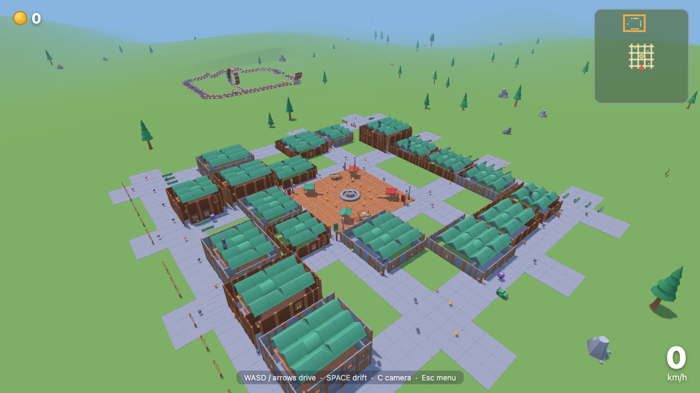

# Toytown Drift

An open-world toy-town driving game that runs entirely in the browser. Pick one of
eight toy cars, cruise a procedurally generated village, and chase lap times on a
stunt-park circuit — all rendered with Three.js from Kenney's CC0 art packs.



## Running it

No build step. Serve the repo over HTTP (the GLBs load textures relative to their
own folders) and open the page:

```sh
python3 -m http.server 8094
# open http://localhost:8094
```

## Controls

| Key | Action |
| --- | --- |
| W / ↑ | accelerate |
| S / ↓ | brake / reverse |
| A D / ← → | steer |
| SPACE | handbrake (drift) |
| C | orbit camera |
| Esc | pause menu |

## Features

- **Garage** — 8 toy vehicles with distinct speed / accel / grip stats.
- **Procedural village** — seeded layout of houses, plaza, windmill (spinning
  blades) and watermill (turning wheel), stream, trees and scenery.
- **Stunt park** — a connected circuit of Kenney track pieces with hills, bumps,
  a launch ramp and a full loop-the-loop, plus a timed lap trial with a
  `localStorage` best time.
- **Collectibles** — coins, crates, and bananas that spin you out; instanced and
  animated.
- **Day/night cycle** — 4-minute day, lanterns light up at dusk (`?day=0.55` to
  jump to night).
- **Feel** — drift smoke, engine hum + pickup/crash SFX via Web Audio, chase and
  orbit cameras, minimap, speedometer.
- **Headless demo mode** — `?demo=1&view=car|village|windmill|watermill|park`
  for screenshots/CI.

## Tests

```sh
node --test tests/
```

10 unit tests cover the pure car physics (acceleration, top speed, braking,
steering, grip, collisions).

## Project layout

```
src/main.js        game bootstrap, loop, cameras, day/night
src/car.js         vehicle stats + pure physics (tested)
src/village.js     seeded world layout + terrain height function
src/world.js       Three.js world: terrain, water, merged props, park
src/entities.js    instanced collectibles
src/collectibles.js pickup rules + time trial
src/hud.js         minimap, banner, timer
src/fx.js          drift smoke particle pool
src/audio.js       Web Audio engine hum + SFX
src/assets.js      cached GLTF loading
```

## Assets & credits

All 3D models and textures are from [Kenney](https://kenney.nl) (CC0):

- Toy Car Kit — `kenney_toy-car-kit/`
- Fantasy Town Kit 2 — `kenney_fantasy-town-kit_2/`

Assets are loaded in place from their original folders and are unmodified.
